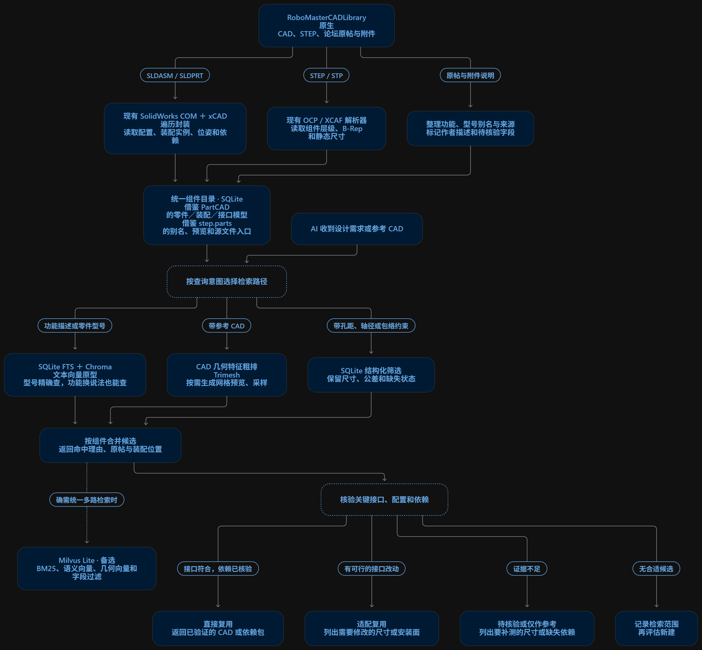

# RoboMaster CAD RAG

面向 RoboMaster 机械设计的本地 CAD 检索与复用库，帮助工程师和 AI 找到已有方案，减少重复建模。

支持按功能描述、零件型号、结构化规格和参考 CAD 查找底盘、悬挂、串联腿、舵轮、机械臂、抓取机构和减速箱。检索结果提供组件卡片、原始 CAD 入口和来源说明，可接入 DSH AutoRoboMaster 机械设计工作台。

当前收录 **3,468 张组件卡片**，覆盖 **2,617 个 CAD 文件入口**。

## 部署

### Windows 启动

1. 下载 [Windows x64 启动包](https://github.com/haku-nomisugiru/robomaster-RAG/releases/download/v0.5.1/RoboMaster-CAD-RAG-v0.5.1-win-x64.zip)，完整解压。
2. 双击 `start-rag.cmd`，保持启动窗口打开。
3. 浏览器访问窗口显示地址后的 `/health`。默认地址为 [http://127.0.0.1:8765/health](http://127.0.0.1:8765/health)。

启动包内置 Python、SQLite、几何索引、Chroma 持久化数据和查询编码器，解压即可检索。

### 接入 RoboMaster 工作台

在工作台根目录的 `settings.json` 中，将 `cad_library_url` 设置为 RAG 启动窗口显示的地址。

```json
"cad_library_url": "http://127.0.0.1:8765"
```

重启工作台，打开“机构检索”，输入需求或型号，例如“3508 双电机舵轮”。

### 获取对应 CAD

在 RAG 解压目录打开 PowerShell，使用检索结果中的卡片 ID 获取 CAD。

```powershell
.\get-cad.cmd rm-803685-014
```

已有作者附件或解压目录时，用 `--from` 导入。

```powershell
.\get-cad.cmd rm-803685-014 --from "D:\下载\原附件.zip"
```

命令会按卡片校验并安装对应文件。完成后，在工作台点击“下载选中模型包”，再点击“打开已下载模型并检查”。

[完整使用文档与 CAD 来源](docs/usage.md) · [HTTP API](reports/HTTP_SERVICE.md)

## 项目结构


